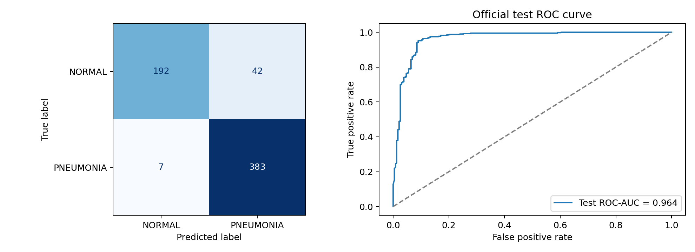
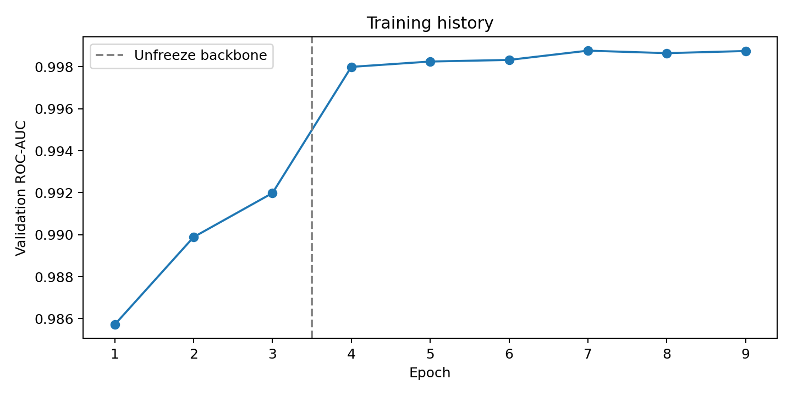
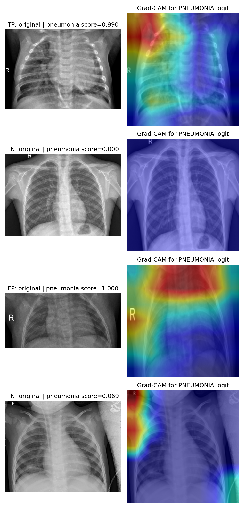

# Pediatric Pneumonia Classification from Chest X-Rays

Transfer learning with ResNet-18, validation-selected recall thresholding, and Grad-CAM analysis.

## Summary

I trained an ImageNet-pretrained ResNet-18 to classify pediatric chest radiographs as `NORMAL` or `PNEUMONIA`. The experiment compared a frozen-backbone baseline against full-network fine-tuning. The operating threshold was selected exclusively on validation predictions, with a target of at least 95% pneumonia recall. I then evaluated the selected checkpoint once on the original 624-image test set.

**Held-out test:** 98.21% pneumonia recall, 90.12% precision, and 0.9640 ROC-AUC. The model missed 7 of 390 pneumonia-labeled images and incorrectly flagged 42 of 234 normal images. These results describe this dataset only; the model is not clinically validated.

## Dataset and split

Source: [Chest X-Ray Images (Pneumonia)](https://www.kaggle.com/datasets/paultimothymooney/chest-xray-pneumonia), hosted by Paul Mooney. The dataset consists of pediatric radiographs originally collected at Guangzhou Women and Children's Medical Center. The Kaggle dataset describes children aged approximately one to five years and lists the dataset license as [CC BY 4.0](https://creativecommons.org/licenses/by/4.0/). Original publication: [Kermany et al., *Cell* (2018)](https://www.cell.com/cell/fulltext/S0092-8674(18)30154-5).

The supplied validation folder contained only 16 images. I combined the original training and validation folders, then created a stratified 85/15 image-level split with seed 42. The original test directory was held out until model and threshold selection were complete.

| Split | Normal | Pneumonia | Total |
| --- | ---: | ---: | ---: |
| Training | 1,147 | 3,300 | 4,447 |
| Validation | 202 | 583 | 785 |
| Official test | 234 | 390 | 624 |

**Caveat:** This is an image-level split, not a verified patient-level split. Patient identifiers and near-duplicate exclusion were not used to establish independence between train and validation images.

## Method

1. Convert X-rays to three-channel images, resize to 224 × 224, and apply ImageNet normalization. Use mild rotations, scaling, and contrast/brightness changes for training only.
2. Replace the pretrained ResNet-18 classifier with two logits (`NORMAL=0`, `PNEUMONIA=1`). Use weighted cross-entropy, assigning the minority `NORMAL` class a weight of approximately 2.877.
3. Train the classifier with the backbone frozen for 3 epochs (AdamW, learning rate `1e-3`), then fine-tune the entire network for 6 epochs (AdamW, `1e-4`).
4. Save the highest validation ROC-AUC checkpoint across both phases. The selected checkpoint came from fine-tuning epoch 4.
5. Select the highest validation score threshold that still yields at least 95% pneumonia recall (`0.392978`). Evaluate once on the original held-out test set.
6. Inspect class-specific Grad-CAM maps for one example each of true positive, true negative, false positive, and false negative predictions.

The training run used Kaggle with PyTorch `2.11.0+cu130` and GPU acceleration. Results are recorded in [`results/metrics.json`](results/metrics.json) and [`results/training_history.json`](results/training_history.json).

## Results

| Metric | Validation | Official test |
| --- | ---: | ---: |
| ROC-AUC | 0.9988 | **0.9640** |
| Pneumonia recall at selected threshold | 95.03% | **98.21%** |
| Pneumonia precision at selected threshold | 99.64% | **90.12%** |
| Specificity | 99.01% | 82.05% |

The baseline reached validation ROC-AUC `0.9920`; the best fine-tuned checkpoint reached `0.9988`. The final checkpoint was selected on unrounded validation ROC-AUC, not on test metrics.

For perspective, a simple Wilson 95% binomial interval for test pneumonia recall is approximately **96.3%–99.1%** (383 of 390). This interval assumes independent test observations and does not address possible patient clustering or dataset shift.

Test confusion matrix (rows = actual class, columns = predicted class):

| | Predicted normal | Predicted pneumonia |
| --- | ---: | ---: |
| Actual normal | 192 | 42 |
| Actual pneumonia | 7 | 383 |

## Grad-CAM inspection

The overlays below target the **pneumonia logit** at the last ResNet residual block. They are qualitative model-attribution visualizations, not pathology segmentations.

The false-positive and false-negative examples show notable activation near image borders or markers rather than only inside the central lung fields. This suggests a possible reliance on acquisition-related shortcuts. The true-positive map includes lung-region activation but is not restricted to it. A small sample of Grad-CAM maps cannot establish causality; a larger audit with lung masking and external data would be needed.

## Interpretation and limitations

- **Validation-to-test drop:** ROC-AUC fell from approximately 0.9988 to 0.9640. The validation and test partitions differ in class prevalence and may differ in image acquisition or patient composition. The image-level split also leaves open potential subject overlap within the training pool.
- **Recall/precision trade-off:** The lower threshold flags 383 of 390 pneumonia-labeled test images, but produces 42 false positives among 234 normal images. This is not a clinically optimized operating point.
- **Domain limits:** The dataset is pediatric and from a limited source. No independent hospital, adult, or prospective cohort was evaluated.
- **Model scores are not calibrated disease probabilities.** Grad-CAM maps do not confirm lesion locations or clinical reasoning.
- **No test-driven retuning:** The official test set was used once for the reported numbers. Model revisions should be evaluated on genuinely independent data, not repeatedly selected against this test set.

**This is an educational computer-vision experiment, not a medical device or diagnostic system.**

## Reproduce the experiment

1. Create a Kaggle Notebook and import [`pneumonia_resnet18_kaggle.ipynb`](pneumonia_resnet18_kaggle.ipynb).
2. Attach [the Kaggle dataset](https://www.kaggle.com/datasets/paultimothymooney/chest-xray-pneumonia) under **Input → Add Input**.
3. Enable a GPU and Internet access for downloading pretrained weights and installing optional packages.
4. Run the cells in order. The notebook writes the checkpoint, metrics, and figures into `/kaggle/working/pneumonia_resnet18/`.

The training seed is fixed to 42, but hardware/library nondeterminism may produce small metric differences. The last notebook cell contains an **optional Gradio demonstration**; that interface was not part of the reported evaluation and was not separately validated in this run.

The trained checkpoint (`resnet18_best.pth`, approximately 45 MB) is deliberately not included in this web-upload repository bundle. It is preserved in the original Kaggle results archive. See [`CHECKPOINT.md`](CHECKPOINT.md) for details.

## References

- [Dataset and stated license](https://www.kaggle.com/datasets/paultimothymooney/chest-xray-pneumonia)
- [TorchVision ResNet-18](https://docs.pytorch.org/vision/main/models/generated/torchvision.models.resnet18)
- [Grad-CAM implementation](https://github.com/jacobgil/pytorch-grad-cam) and [original paper](https://arxiv.org/abs/1610.02391)
- [Scikit-learn evaluation metrics](https://scikit-learn.org/stable/modules/model_evaluation.html)

- ## Development Acknowledgment

This project was developed with AI assistance for
debugging, technical explanations, and documentation.

Model training and evaluation were executed in Kaggle, and the
reported results were reviewed by the repository maintainer.
